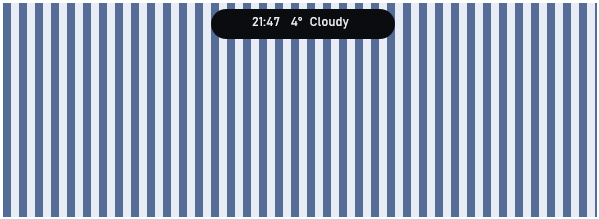
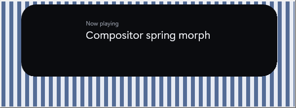
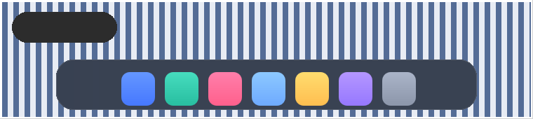
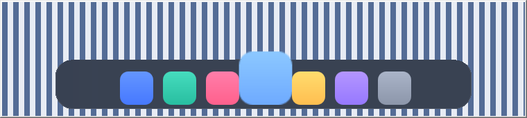
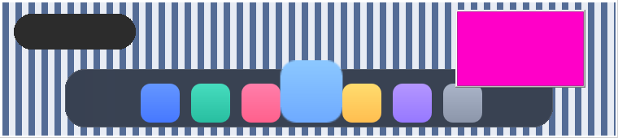

# Spike S1 — WinUI 3 shell surfaces (ADR-001 validation)

**Date:** 2026-11-21
**Machine:** i7-6700K, GTX 970, 16 GB, Windows 11 25H2 (26200), 1680×1050 at 96 DPI
**Code:** `prototypes/S1-ShellSurfaces`. Run `run-spike.ps1`.
**Result:** ✅ **passed.** Every check measured on the real desktop: pixels via screen capture, OS state via Win32.

## Findings that shaped the architecture
1. **A plain WinUI `Window` is opaque.** That holds even with a transparent `SystemBackdrop`, because the top-level WinUI HWND is *redirected* and its redirection surface ignores alpha.
   - Fix: `DwmExtendFrameIntoClientArea(-1)` plus a transparent system brush backdrop. This gives true per-pixel alpha.
   - Alternative that also works: a XAML island (`DesktopWindowXamlSource`) inside our own `WS_EX_NOREDIRECTIONBITMAP` popup.
   - Setting a custom `SystemBackdrop` on a `DesktopWindowXamlSource` crashes in 2.7 (native AV in coreclr). Avoid it.
2. **Stock `DesktopAcrylicBackdrop` turns solid grey on windows that never take focus**, which is every shell surface. Fix: a custom `SystemBackdrop` that drives `DesktopAcrylicController` with `SystemBackdropConfiguration.IsInputActive = true`. Real acrylic was verified over live desktop content.
3. **Click-through outside shapes** uses window regions sized to the visible shape and inflated 2 px. The 2 px band keeps anti-aliased edges, and it is transparent, so it shows no halo.
4. **The metapackage `Microsoft.WindowsAppSDK` drags in ~65 MB of on-device AI/ML/Search runtime.** Referencing `Microsoft.WindowsAppSDK.WinUI` alone (Foundation, InteractiveExperiences, Base come transitively) cut the self-contained output from 281.6 MB to 216.9 MB.
5. **No VC++ runtime dependency.** No shipped binary imports `vcruntime140`, `msvcp140` or `concrt140`.

## Measurements (Release, ReadyToRun, self-contained)
| Check | Result |
|---|---|
| Capsule transparency (pixels below and beside the capsule equal the background) | 97.3 % / 95.4 % |
| Dock transparency above the slab | 100 % |
| Hit-test: inside capsule / beside / below | ✅ / passes through / passes through |
| Hit-test: dock slab / magnified-icon overflow / empty area | ✅ / ✅ / passes through |
| Spring morph keeps running while the UI thread is blocked for 350 ms | ✅ width changed by 327 px (compositor-driven) |
| Spring curve, width over time (px) | 184 → 250 → 432 → 508 → 514 (overshoot) → 506 → 508 settled |
| Focus stealing, Alt+Tab visibility | no / hidden |
| Rendering adapter, effects | NVIDIA GeForce GTX 970 (4 GB), effects supported and fast |
| GPU 3D engine utilization during repeated morphs | 0.76 % |
| DWM live thumbnail inside a WinUI surface | 100 % coverage |
| AppBar reserves 34 px and restores the work area | ✅ |
| Bar + capsule + dock, idle 30 s | **0.059 %** CPU of the machine (0.47 % of one core) |
| Same, animating every second | 1.19 % CPU of the machine |
| Private memory / working set | 98 MB / 119 MB |
| Process start → first frame (three surfaces) | 780 ms |

## Screenshots
| | |
|---|---|
|  |  |
|  |  |
|  |  |
